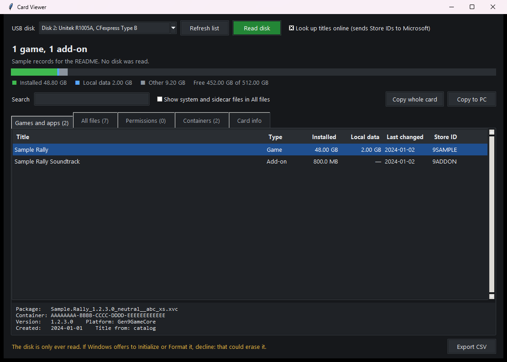
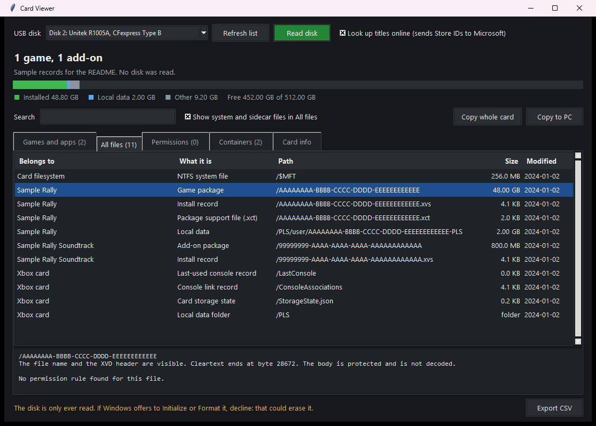
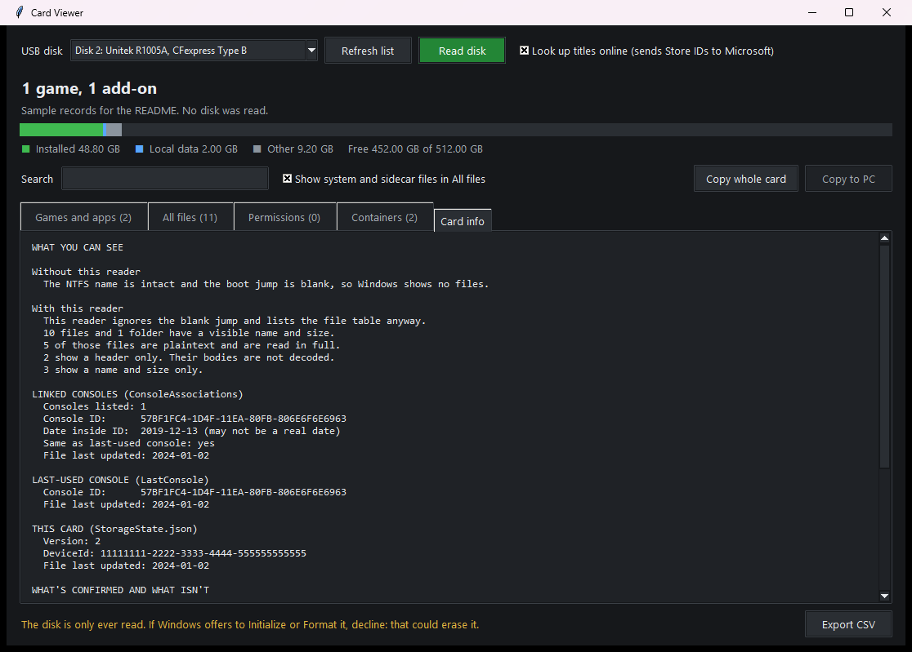
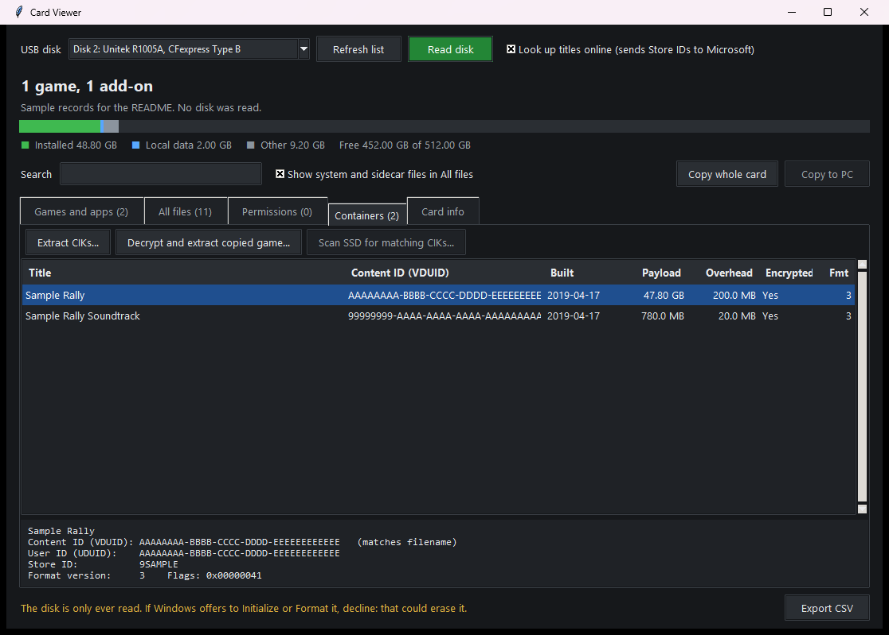

# disk-reader

Read-only tools for a storage card Windows will not mount. The card is attached with a CFexpress Type B reader. This project was developed with a [Unitek R1005A](https://www.amazon.com/dp/B083W2XJBM) (USB 3.2, model R1005A).

Windows shows no file list when the volume boot jump is blank. These tools still walk the NTFS file table and report what is actually visible:

- small plaintext records, in full
- a container's XVD header, including where cleartext ends
- every other file as a name and a size

Protected container bodies are not decoded. Nothing here writes to the card. If Windows offers to initialize or format the disk, decline that.

The screenshots below use sample records, not a dump of a card.

## Card Viewer



Titles, sizes, and local data. Store names come from Microsoft's display catalog when online lookup is on. That lookup sends Store IDs only.



Each file says whether its body was read, whether only the header was read, or whether the name and size are all that is shown.



The card panel states the boot-sector reason Windows has no file list, then the counts from the file table. Console records underneath are what those small files contain. Their field names are inferred from the files, not from a published spec.



Header fields are plaintext. The payload is not decoded.

## Run

Card Viewer needs Administrator because it opens `\\.\PhysicalDriveN` read-only. It lists USB disks only.

```
python card_viewer.py
```

`Card Viewer.bat` starts the same script. `build_exe.bat` builds a windowed executable with PyInstaller. The build virtualenv and `dist/` are local and are not part of this repository.

A raw scan, without the viewer:

```
python disk_reader.py scan --disk N --out report.json
python disk_reader.py ls --disk N --out-dir listing
```

`recomp_planner.py` sorts titles by what a native PC version would take. It reads the title list and public store pages. It does not open containers.

```
python -m unittest
```

## Sources

| Piece | Source |
| --- | --- |
| Card attachment used here | [Unitek R1005A CFexpress Type B reader](https://www.amazon.com/dp/B083W2XJBM) |
| NTFS boot sector, MFT, attributes, runlists | Microsoft's NTFS on-disk format. `ntfs_reader.py` is not a port of another parser. |
| NTFS security descriptors and well-known SID names | Microsoft's security-descriptor documentation. |
| XVD/XVC header offsets, including positions still marked tentative, and the XvcInfo layout | [emoose/xvdtool](https://github.com/emoose/xvdtool), GPL-2.0. Confirmed offsets were also checked against a real card. |
| External extractor the Containers tab can launch | [emoose/xvdtool](https://github.com/emoose/xvdtool), GPL-2.0. Not included in this repo. |
| External CIK program the Containers tab can launch | [LukeFZ/CikExtractor](https://github.com/LukeFZ/CikExtractor), MIT. Not included in this repo. |
| Title names | [Microsoft display catalog](https://displaycatalog.mp.microsoft.com) |
| PC-availability lookups | [Steam store search](https://store.steampowered.com/api/storesearch/), [GOG catalog](https://catalog.gog.com), and the unofficial tracker at [portedgames.com/recompiled-games](https://portedgames.com/recompiled-games/) |

Those external programs keep their own licenses. This repository does not vendor their binaries.
